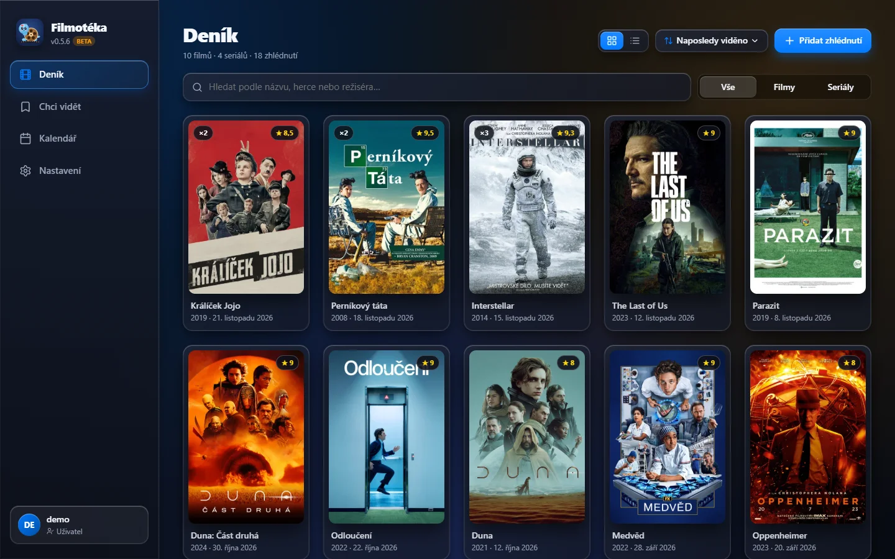
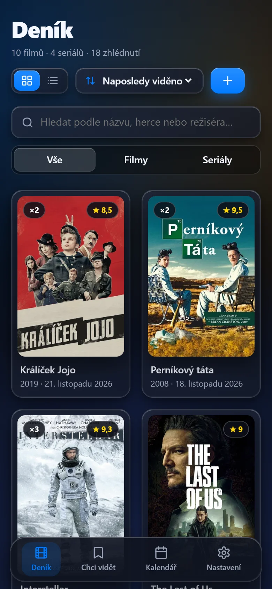
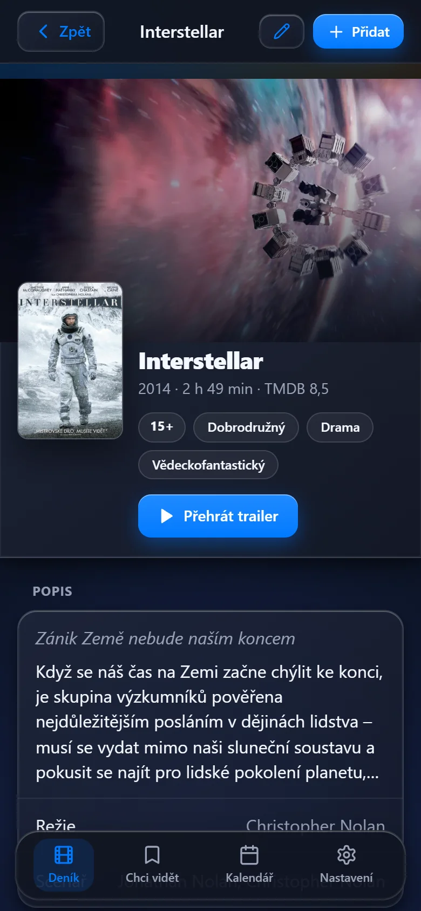
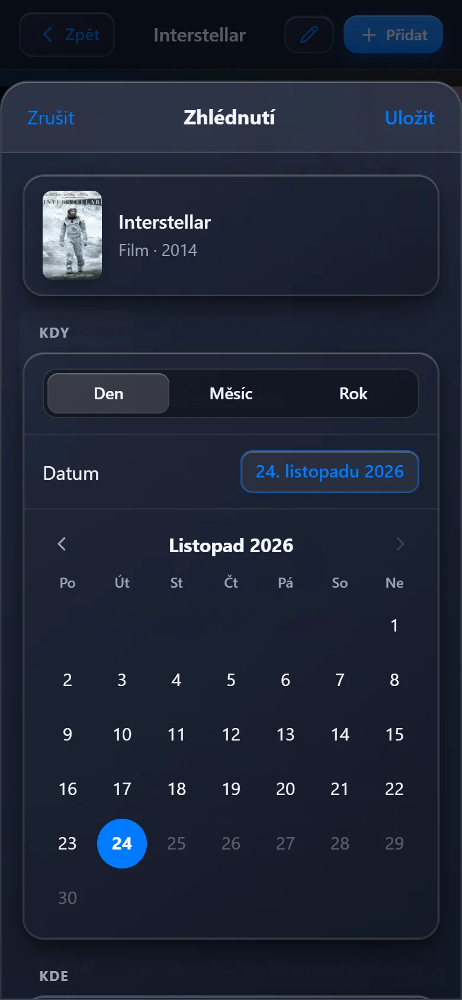
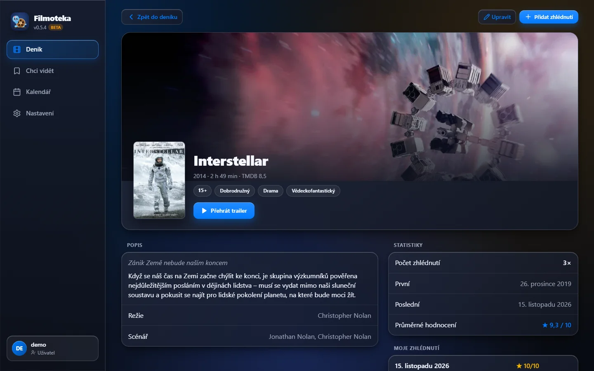
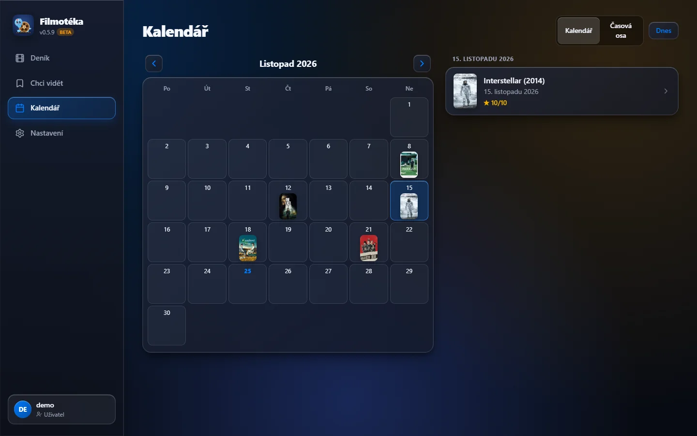
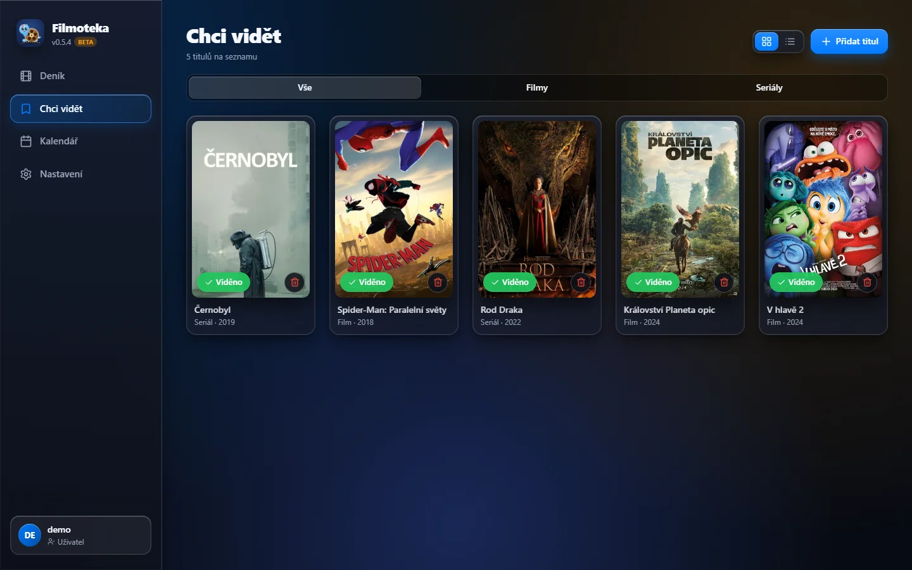

<div align="center">


# Filmoteka

**Rodinná časová kapsle filmů a seriálů.**
Zaznamenej každé zhlédnutí (kdy, kde, hodnocení, poznámka) a vždycky uvidíš, kolikrát a kdy naposledy jsi titul viděl.

[**filmoteka-denik.vercel.app**](https://filmoteka-denik.vercel.app) · Next.js PWA · Supabase · TMDB

</div>



<p align="center">
  
  &nbsp;
  
  &nbsp;
  
</p>

## Co umí

- **Deník zhlédnutí:** mřížka plakátů nebo seznam, počet zhlédnutí a průměrné hodnocení u každého titulu, řazení a filtr filmy / seriály.
- **Vyhledávání podle názvu, herce i režiséra** v deníku i při přidávání titulu z TMDB.
- **Detail titulu:** popis, žánry, věková hranice, trailer, herci a obsazení, statistiky a všechna tvoje zhlédnutí s rychlou úpravou.
- **Zhlédnutí s přesností na den, měsíc nebo rok,** místo (Netflix, kino, Jellyfin…), hodnocení 1–10, poznámka a u seriálů sezóna.
- **Kalendář a časová osa:** co jsi kdy viděl, s plakáty přímo ve dnech.
- **Chci vidět:** seznam titulů na později, jedním klepnutím přesuneš do deníku.
- **Soukromé:** každý uživatel vidí jen svá data (Supabase RLS), ani správce nevidí cizí deník.
- **Na iPhonu jako aplikace:** PWA na celou obrazovku, bez App Storu a bez vypršení.
- **Vzhled:** světlý / tmavý motiv a volitelná barva akcentu.

<table>
  <tr>
    <td></td>
    <td></td>
  </tr>
  <tr>
    <td align="center">Detail titulu</td>
    <td align="center">Kalendář</td>
  </tr>
  <tr>
    <td colspan="2"></td>
  </tr>
  <tr>
    <td colspan="2" align="center">Chci vidět</td>
  </tr>
</table>

## Technologie

| Část | Použito |
|---|---|
| Aplikace | Next.js 15 (App Router), React 19, TypeScript, PWA |
| Data a přihlášení | Supabase (Postgres s RLS, Auth, Edge Functions `tmdb` a `admin`) |
| Filmy a seriály | TMDB API přes Edge Function, klíč není v aplikaci |
| Hosting | Vercel (automatický deploy z `main`), případně Raspberry Pi + Tailscale Funnel |

Struktura:
- `src/` aplikace a serverové API routy (`/api/tmdb`, `/api/admin`, `/api/keepalive`)
- `public/` PWA manifest a ikony
- `supabase/` migrace databáze, testy izolace dat (`npm run test:db`) a Edge Functions
- `docs/screenshots/` obrázky do tohoto README (demo účet s ukázkovými daty)

Účty nemají e-mail: přihlašuje se uživatelským jménem a heslem (např. `tpolanek`). Interní e-mail `<jméno>@users.filmoteka.app` se nikde neukazuje. **Veřejná registrace není**, účty zakládá správce v **Nastavení → Uživatelé**.

---

## 1. Databáze (Supabase)

1. Supabase Dashboard → SQL Editor → postupně vlož obsah každého souboru `supabase/migrations/*.sql` (`0001_init.sql` až `0005_remove_family_add_profiles.sql`) → Run.
2. Authentication → Sign In / Providers → Email: provider nech zapnutý a **„Confirm email“ vypni**.
3. Vytvoř první účet (Authentication → Users → Add user, e-mail `<jméno>@users.filmoteka.app`) a udělej z něj správce (viz [Správa účtů](#6-správa-účtů-a-zapomenuté-heslo)).
4. **Vypni „Allow new users to sign up“** (Authentication → Sign In / Providers). Jinak by si účet mohl založit kdokoli přímo přes API. Zakládání účtů v aplikaci funguje dál, funkce `admin` používá service role.
5. Edge Functions `tmdb` a `admin`:
   ```bash
   supabase secrets set TMDB_TOKEN=eyJ... --project-ref <ref>
   supabase functions deploy tmdb --no-verify-jwt --project-ref <ref>
   supabase functions deploy admin --no-verify-jwt --project-ref <ref>
   ```

---

## 2. Lokální spuštění

```bash
cp .env.example .env.local   # vyplň URL a publishable klíč ze Supabase
npm install
npm run dev
```

Pak otevři `http://localhost:3000`.

---

## 3. Nasazení: Vercel

1. Na [vercel.com](https://vercel.com) → **Add New → Project** → repozitář `Tomas-Polanek/filmoteka`.
2. **Environment Variables:**
   - `NEXT_PUBLIC_SUPABASE_URL` = `https://<project-ref>.supabase.co`
   - `NEXT_PUBLIC_SUPABASE_PUBLISHABLE_KEY` = `sb_publishable_...`
3. **Deploy.** Každý push do `main` se nasadí automaticky.
4. Doména: Project → Settings → Domains → **Add Domain** (zdarma ve tvaru `<jméno>.vercel.app`).
5. `vercel.json` nastaví Cron (`/api/keepalive` každé 4 dny), aby se Supabase Free projekt po 7 dnech neuspal.

---

## 4. Nasazení: Raspberry Pi + Tailscale Funnel

1. Na Raspberry Pi:
   ```bash
   git clone https://github.com/Tomas-Polanek/filmoteka.git
   cd filmoteka
   cp .env.example .env.local
   nano .env.local   # NEXT_PUBLIC_SUPABASE_URL, NEXT_PUBLIC_SUPABASE_PUBLISHABLE_KEY
   npm install
   npm run build
   npm start         # port 3000, trvale např. přes pm2 nebo systemd
   ```
2. Zveřejnění s HTTPS:
   ```bash
   sudo tailscale funnel --bg 3000
   ```
   Tailscale vypíše adresu `https://<nazev-rpi>.<tailnet>.ts.net`. Jen pro zařízení v tailnetu použij místo `funnel` příkaz `sudo tailscale serve --bg 3000`.

---

## 5. Instalace na plochu iPhonu (PWA)

1. Otevři adresu aplikace v **Safari**.
2. **Sdílet** (čtvereček se šipkou) → **Přidat na plochu**.
3. Filmoteka se spouští na celou obrazovku s vlastní ikonou jako nativní aplikace.

---

## 6. Správa účtů a zapomenuté heslo

- **První správce** (jednorázově v Supabase SQL Editoru):
  ```sql
  update public.profiles set role = 'admin' where username = 'tpolanek';
  ```
- **Další účty** zakládá správce v **Nastavení → Uživatelé**.
- **Zapomenuté heslo:** nové heslo nastaví správce v **Nastavení → Uživatelé → uživatel → Nastavit heslo**. Když ho zapomene poslední správce, nastaví si ho v SQL Editoru:
  ```sql
  update auth.users
  set encrypted_password = extensions.crypt('nove-heslo', extensions.gen_salt('bf'))
  where email = 'tpolanek@users.filmoteka.app';
  ```

---

## Verze

Historie změn je v [CHANGELOG.md](CHANGELOG.md) a v aplikaci v **Nastavení → Co je nového**.
